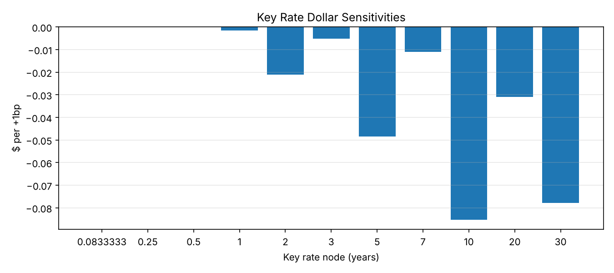
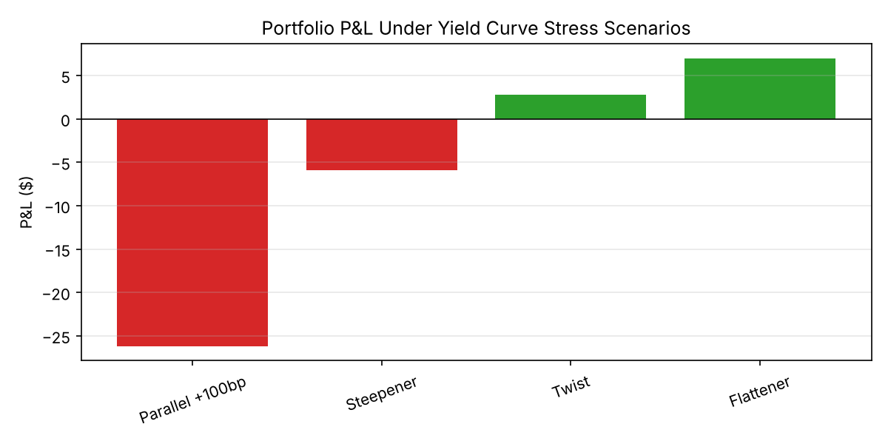
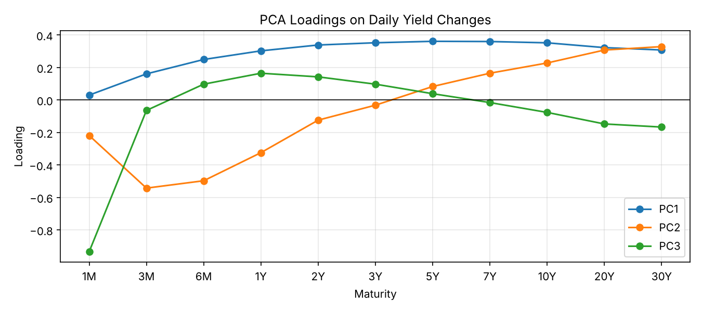

# Interest Rate Risk & Yield Curve Stress Testing

Measures how a Treasury bond portfolio's value changes when the yield curve moves. Each run downloads real daily yield curve data from the U.S. Treasury (home.treasury.gov), so the results are always up to date.

The analysis covers:

1. **Pricing**: values each bond off the current yield curve.
2. **DV01**: dollar change in portfolio value for a +1bp parallel move.
3. **Key rate duration (KRD)**: moves one curve point at a time to show which maturities hold the risk.
4. **Stress scenarios**: parallel +100bp, steepener, flattener, and twist.
5. **PCA**: finds the three main ways the curve moves (level, slope, curvature) from history, then prices a 2-sigma move in each one.

## Run it

```bash
pip install -r requirements.txt
python run.py                         # download data, run on the latest date
python run.py --date 2024-06-28       # run on an older date
python run.py --start-year 2010       # use more history for PCA
python run.py --use-cache             # skip the download, reuse the last one
python -m pytest                      # offline tests
IRR_NETWORK_TESTS=1 python -m pytest  # also test the live download
```

Tables (CSV) and charts (PNG) go to `outputs/`. The downloaded data is saved to `data/treasury_yields.csv` (not committed).

## Project layout

```
irr/
  data.py        download and clean Treasury yield data
  curve.py       map tenors (1M..30Y) to years, pick the curve for a date
  pricing.py     bond and portfolio pricing
  risk.py        DV01 and key rate durations
  scenarios.py   curve shocks and scenario P&L
  pca.py         PCA on daily yield changes, PCA shocks
  plots.py       charts
run.py           runs everything from the command line
tests/           pytest checks (run offline on sample data)
```

## Method

**Data.** [Daily Treasury Par Yield Curve Rates](https://home.treasury.gov/resource-center/data-chart-center/interest-rates/TextView?type=daily_treasury_yield_curve) from the U.S. Treasury, from 2018 to today. No API key is needed. The code uses 11 tenors: 1M, 3M, 6M, 1Y, 2Y, 3Y, 5Y, 7Y, 10Y, 20Y, 30Y. It changes percent to decimal (4.86 → 0.0486) and drops days with a missing tenor.

**Portfolio.** Four Treasuries with $100 face each: 2Y (3.5%), 5Y (3.7%), 10Y (4.0%), 30Y (4.5%). Annual coupons.

**Pricing.** Each cash flow is discounted at the curve yield for its date, using linear interpolation between tenors and continuous compounding:

$$P = \sum_{t=1}^{T} CF_t \, e^{-y_t t}$$

**DV01 and KRD.** DV01 is the value change for a +1bp shift of the whole curve. KRD bumps one tenor by +1bp and leaves the others alone. The sum of the 11 key rate changes should equal DV01 (check below).

**Stress scenarios.**

| Scenario | Short end | Long end |
|---|---|---|
| Parallel +100bp | +100bp | +100bp |
| Steepener | −50bp (≤5Y) | +50bp (>5Y) |
| Flattener | +50bp (≤5Y) | −50bp (>5Y) |
| Twist | +25bp (<2Y), 0 for 2Y–10Y | −25bp (>10Y) |

**PCA.** PCA runs on standardized daily yield changes. Signs are fixed so PC1 is "all rates up" and PC2 is "long end up, short end down", so results do not flip between runs. Each shock is 2 standard deviations of that PC's daily score, converted back to yield changes.

## Results (as of 2026-11-06, 2,213 trading days of history)

These numbers change each time you run it on new data.

| Metric | Value |
|---|---|
| Portfolio value | $374.19 |
| DV01 | −$0.2813 |
| Sum of key rate DV01s | −$0.2813 (difference 2.3e-5) |
| Largest key rate exposures | 10Y (30%), 30Y (28%), 5Y (17%) |

| Scenario | P&L |
|---|---|
| Parallel +100bp | −$26.20 |
| Steepener | −$5.94 |
| Twist | +$2.78 |
| Flattener | +$6.98 |

| PCA factor | Variance explained | 2σ daily P&L |
|---|---|---|
| PC1 (Level) | 65.5% | −$2.79 |
| PC2 (Slope) | 14.4% | −$0.77 |
| PC3 (Curvature) | 9.0% | +$0.19 |

The first three factors explain 88.9% of daily curve moves. Level is the main risk; the portfolio loses when rates rise and when the curve steepens.





## Limits

- Coupons are annual. Real Treasuries pay semiannually.
- Par yields are used as zero rates (no bootstrapping).
- Daily changes, so PCA shocks are 1-day moves.
